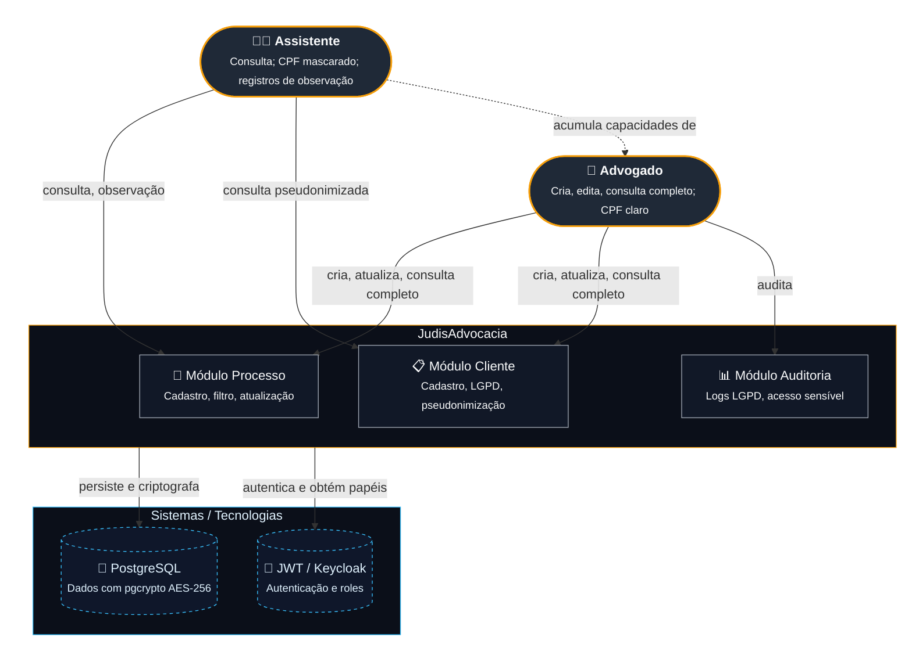
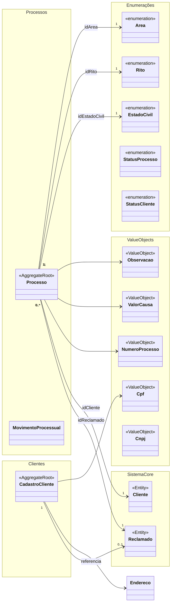
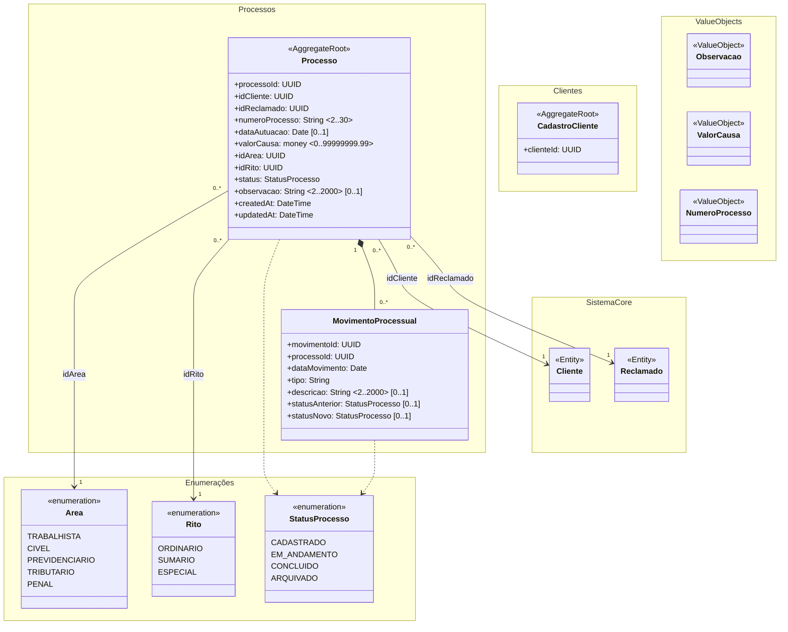
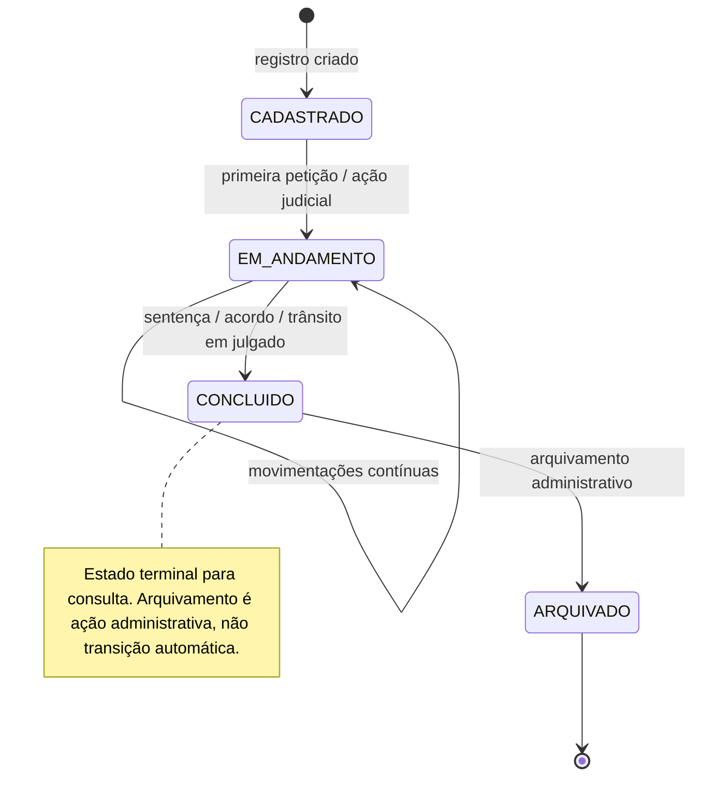
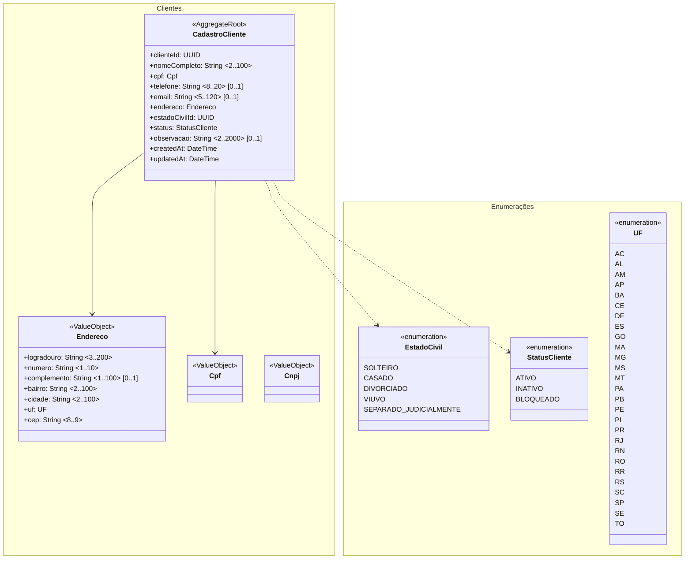

# Modelo geral do domínio — JudisAdvocacia — Gestão Processual Judicial

## 1. Objetivo

O sistema controla o ciclo de vida de **processos judiciais** para um escritório de advocacia, desde a abertura do processo até o acompanhamento de movimentações, com gestão de **clientes** (autores) e **reclamados** (partes adversas), classificação por **área jurídica** e **rito processual**, e controle de **dados sensíveis** conforme a LGPD (Lei nº 13.709/2018).

Os principais conceitos cobertos pelo modelo são: cadastro de processos, vinculação a partes (Cliente/Reclamado), classificação jurídica (Área/Rito), estado civil da pessoa física, controle de acesso por role (advogado, assistente, admin) e registro de auditoria de acesso a dados sensíveis.

> Observação: os limites de agregado apresentados são uma proposta orientada à simplicidade. Se o volume de processos superar 100.000 registros com alta concorrência de escrita, o `CadastroCliente` poderia ser promovido a raiz independente, separando a consistência transacional de cadastro da consistência de processo.

> Observação: `Cliente` (autor) é sempre pessoa física (`Cpf` obrigatório, `EstadoCivil` obrigatório, sem `CNPJ`). `Reclamado` pode ser pessoa física (`Cpf`) ou pessoa jurídica (`CNPJ`) — esta distinção é registrada no domínio como uma observação de contexto.

> Observação: o vínculo 1..1 entre `Cliente` e `Cpf` é modelado como atributo direto embutido no agregado `CadastroCliente`; não há entidade intermediária porque o CPF é parte inseparável do cadastro da parte.

<br>

## 1.1 Personas

O `JudisAdvocacia` é operado por profissionais autorizados autenticados via JWT (Keycloak simplificado no MVP):

| Persona | Papel (JWT / Role) | Contexto de uso | Responsabilidade no sistema |
|---|---|---|---|
| <b>Advogado</b> | `advogado` | Desktop / notebook; frequência alta (múltiplos processos por dia) | Criar, editar, consultar processos; acessar CPF completo; decidir sobre movimentações. |
| <b>Assistente</b> | `assistente` | Desktop / tablet; frequência média | Consultar processos; visualizar CPF pseudonimizado; registrar observações; **não pode alterar nem cadastrar `valorCausa`**. |
| <b>Administrador</b> | `admin` | Desktop; frequência baixa | Auditar logs de acesso; configurar roles; acessar todos os dados. |

> Observação: `Advogado` acumula capacidades de `Assistente`; a separação exata de permissões por endpoint fica no middleware FastAPI, não no modelo de domínio. A restrição de domínio para `Assistente` é: não pode alterar nem cadastrar o atributo `valorCausa` do agregado `Processo`. Esta regra é refletida como uma restrição de aplicação, mas está registrada no domínio como uma limitação funcional da persona.



<br><br>

---

## 2.1 Value Objects e Enumerações

| Namespace | Classe | Tipo | Usada por |
|---|---|---|---|
| ValueObjects | `Cpf` | Value Object (criptografado) | `CadastroCliente` |
| ValueObjects | `NumeroProcesso` | Value Object | `Processo` |
| ValueObjects | `Observacao` | Value Object | `Processo`, `CadastroCliente` |
| ValueObjects | `ValorCausa` | Value Object (**money** — PostgreSQL `money`) | `Processo` |
| ValueObjects | `Endereco` | Value Object | `CadastroCliente` |
| Enumerações | `StatusProcesso` | Enumeração | `Processo` |
| Enumerações | `StatusCliente` | Enumeração | `CadastroCliente` |
| Enumerações | `EstadoCivil` | Enumeração | `CadastroCliente` |
| Enumerações | `Area` | Enumeração | `Processo` |
| Enumerações | `Rito` | Enumeração | `Processo` |

---

## 2.2 Entidades

| Namespace | Entidade | Tipo | Agregado | Mantida em | Responsabilidade |
|---|---|---|---|---|---|
| Processos | `Processo` | Entidade interna (raiz) | `Processo` | `JudisAdvocacia` | Controle do processo judicial. |
| Processos | `MovimentoProcessual` | Entidade interna | `Processo` | `JudisAdvocacia` | Movimentações dentro do processo. |
| Clientes | `CadastroCliente` | Entidade cadastral (raiz) | `CadastroCliente` | `JudisAdvocacia` | Dados pessoais do cliente/reclamado. |
| Clientes | `Reclamado` | Entidade cadastral | — | `JudisAdvocacia` | Parte adversa, referenciada por `ReclamadoId`. |

---

## 2.3 Agregados

| Namespace | Agregado | Raiz | Entidades internas | Responsabilidade |
|---|---|---|---|---|
| Processos | Processo | `Processo` | `MovimentoProcessual` | Controle do ciclo de vida do processo. |
| Clientes | CadastroCliente | `CadastroCliente` | — | Consistência dos dados sensíveis. |



---

### Notação de multiplicidade dos atributos

Vale o padrão UML: **atributo sem anotação tem multiplicidade `1`** — é obrigatório. Só a multiplicidade que difere de `1` é anotada ao final da linha: `[0..1]`, `[1..*]`, `<min..max>`.

---

## 4.1 Namespace `Processos`

### 4.1.1 Modelo



### 4.1.2 Descrição dos atributos

#### `{Processo}`

| Atributo | Tipo | Mult. | Range | Descrição |
|---|---|---|---|---|
| `processoId` | UUID | 1 | — | Identificador da raiz do agregado. |
| `idCliente` | UUID | 1 | — | Referência obrigatória ao `CadastroCliente` (autor). |
| `idReclamado` | UUID | 1 | — | Referência obrigatória ao `Reclamado` (parte adversa). |
| `numeroProcesso` | String | 1 | 2..30 | Número do processo judicial (formato: XXX.YY.ZZZZ...). |
| `dataAutuacao` | Date | 0..1 | — | Data de autuação; obrigatório quando registrado. |
| `valorCausa` | **money** | 1 | 0..99999999.99 | Valor monetário da causa (tipo PostgreSQL `money`; preserva 2 casas decimais, evita perda em conversões). |
| `idArea` | UUID | 1 | — | Referência à área jurídica. |
| `idRito` | UUID | 1 | — | Referência ao rito processual. |
| `status` | StatusProcesso | 1 | — | Estado atual do processo; ver 4.1.3. |
| `observacao` | String | 0..1 | 2..2000 | Observação interna; pode conter dados sensíveis — logada. |
| `createdAt` | DateTime | 1 | — | Timestamp criação. |
| `updatedAt` | DateTime | 1 | — | Timestamp última atualização. |

#### `{MovimentoProcessual}`

| Atributo | Tipo | Mult. | Range | Descrição |
|---|---|---|---|---|
| `movimentoId` | UUID | 1 | — | Identificador do movimento. |
| `processoId` | UUID | 1 | — | Vínculo obrigatório com `Processo`. |
| `dataMovimento` | Date | 1 | — | Data do evento no processo. |
| `tipo` | String | 1 | 2..50 | Tipo do movimento (ex.: petição, resposta, apelacao). |
| `descricao` | String | 0..1 | 2..2000 | Descrição detalhada. |
| `statusAnterior` | StatusProcesso | 0..1 | — | Status anterior ao movimento. |
| `statusNovo` | StatusProcesso | 0..1 | — | Status após o movimento. |

### 4.1.3 Máquina de estados de `StatusProcesso`



---

## 4.2 Namespace `Clientes`

### 4.2.1 Modelo



### 4.2.2 Descrição dos atributos

#### `{CadastroCliente}`

| Atributo | Tipo | Mult. | Range | Descrição |
|---|---|---|---|---|
| `clienteId` | UUID | 1 | — | Identificador da raiz. |
| `nomeCompleto` | String | 1 | 2..100 | Nome completo da parte física ou razão social. |
| `cpf` | Cpf | 1 | — | CPF criptografado; obrigatório para pessoa física. |
| `telefone` | String | 0..1 | 8..20 | Telefone de contato. |
| `email` | String | 0..1 | 5..120 | E-mail para notificações. |
| `endereco` | Endereco | 1 | — | Endereço completo; obrigatório. |
| `estadoCivilId` | UUID | 1 | — | Referência à `EstadoCivil`; obrigatório para pessoa física (cliente sempre PF). Em caso de menor, `Cpf` e `EstadoCivil` são do responsável legal; menor não é `CadastroCliente` independente. |
| `status` | StatusCliente | 1 | — | Estado do cadastro. |
| `observacao` | String | 0..1 | 2..2000 | Observação interna; pode conter dados sensíveis — logada. |
| `createdAt` | DateTime | 1 | — | Timestamp criação. |
| `updatedAt` | DateTime | 1 | — | Timestamp atualização. |

---

| Processos | `Processo` | `Cliente` | Clientes | `idCliente` | `0..* → 1` | sim |
| Processos | `Processo` | `Reclamado` | Clientes | `idReclamado` | `0..* → 1` | sim |
| Processos | `Processo` | `Area` | Enumerações | `idArea` | `0..* → 1` | sim |
| Processos | `Processo` | `Rito` | Enumerações | `idRito` | `0..* → 1` | sim |
| Processos | `Processo` | `StatusProcesso` | Enumerações | `status` | `1 → 1` | sim |
| Clientes | `CadastroCliente` | `EstadoCivil` | Enumerações | `estadoCivilId` | `0..1 → 1` | não |
| Clientes | `CadastroCliente` | `Cpf` | ValueObjects | `cpf` | `1 → 1` | sim |

---

## 4.{M+2} Atributos com obrigatoriedade condicional

| Classe | Atributo | Obrigatório quando | Deve ser nulo quando |
|---|---|---|---|

| `CadastroCliente` | `cpf` | Sempre obrigatório (`1`) | — | Cliente é sempre pessoa física; `EstadoCivil` obrigatório. |
| `CadastroCliente` | `estadoCivilId` | Pessoa física (CPF obrigatório) | — |

---


## 5.1 Processo

```text
Cliente (CadastroCliente) 1 ---- 0..* Processo
Reclamado (CadastroCliente) 1 ---- 0..* Processo
Processo 1 ---- 1..* MovimentoProcessual
```

Explicação: o Processo pertence a exatamente um Cliente (autor) e um Reclamado (parte adversa). MovimentoProcessual pode ocorrer 0..*. Associação é referência por ID (idCliente, idReclamado), não composição interna.

---

# 6. Cadeia central do domínio

```text
CadastroCliente
  |
  +--- Processo (autoria / réu)
         |
         +--- Area / Rito / EstadoCivil
         |
         +--- MovimentoProcessual (ciclo de vida)
         |
         +--- Observacao (dados internos / sensíveis)
```

Cenário: advogado cadastra CadastroCliente (CPF criptografado, endereço completo). Cria Processo vinculando idCliente, selecionando Area (TRABALHISTA) e Rito (ORDINARIO), incluindo ValorCausa (R$ 15.000). Quando primeira petição registrada, MovimentoProcessual criado, alterando StatusProcesso de CADASTRADO para EM_ANDAMENTO. Apenas Advogado e Admin acessam Cpf em texto claro; Assistente vê apenas CPF pseudonimizado.

---

# 7. Regras dos agregados

## 7.1 Processo

Raiz: Processo. Entidades internas: MovimentoProcessual (0..*).

Invariantes:
- MovimentoProcessual.processoId referencia exatamente uma raiz Processo.
- StatusProcesso só aceita transições listadas; proibidas: ARQUIVADO -> CADASTRADO.
- idCliente e idReclamado obrigatórios (1).
- observacao, se presente, deve ser registrada em logs_acesso.
- `ValorCausa` obrigatório (`1`), mínimo `0`. **Restrição de persona:** apenas `Advogado` (role `advogado`) pode criar ou alterar `ValorCausa`; `Assistente` (role `assistente`) pode consultar, mas não modificar — esta é a distinção de domínio entre as duas personas.
- statusNovo obrigatório em transições de status.

---

# 8. Segurança, LGPD e Auditoria

Todos os campos Cpf/Cnpj criptografados (AES-256 pgcrypto). Nenhum endpoint retorna Cpf claro para assistente. Observacao pode conter dados sensíveis — registrada no log. Middleware FastAPI separa por role.

---

# 9. Diagrama simplificado final

```text
CADASTRO_CLIENTE
  |
  +---- PROCESSO
         |
         +---- MOVIMENTO_PROCESSUAL
         |
         +---- OBSERVACAO
         |
         +---- STATUS / VALOR / DATA / NUMERO
```

---

# 10. Raízes recomendadas

Processo
CadastroCliente

Entidades subordinadas: MovimentoProcessual, Cpf, Cnpj, Observacao, NumeroProcesso, ValorCausa, Area, Rito, EstadoCivil.

Reclamado mantido como referência (não raiz independente no MVP), conforme simplificação do spec.md.

---

# 11. Questões em aberto

## 11.1 Pseudonimização CPF — RESOLVIDO

**Resposta:** Sim. `Cpf` é obrigatório (`1`) no `CadastroCliente`. Para `assistente` (role `assistente`), o CPF é pseudonimizado (ex.: `***.***.***-XX` — últimos 3 dígitos visíveis). Para `advogado` e `admin`, retorno em texto claro via middleware FastAPI. **Decisão registrada:** a pseudonimização é uma regra de aplicação (access control), não altera o modelo de domínio; `Cpf` permanece como `ValueObject` obrigatório.

## 11.2 Escopo MovimentoProcessual — RESOLVIDO

**Resposta:** Não. `MovimentoProcessual` permanece subordinado ao agregado `Processo` no MVP (ver `docs/adr/0001-cliente-cpf-uf-estado-civil.md`). (`0..*` interno). Não há raiz independente `MovimentoProcessual`. Movimentações administrativas (ex.: arquivamento) são registradas como `MovimentoProcessual` vinculadas ao `Processo` existente, preservando a consistência transacional da raiz. **Decisão:** manter simplicidade do MVP conforme `spec.md`; se necessário no futuro, avaliar separação em fase 2.

---

<!-- CHECKLIST REVISAO (apague antes de publicar) -->
<!-- [x] Secoes consistentes -->
<!-- [x] Nenhum marcador {…} restante -->