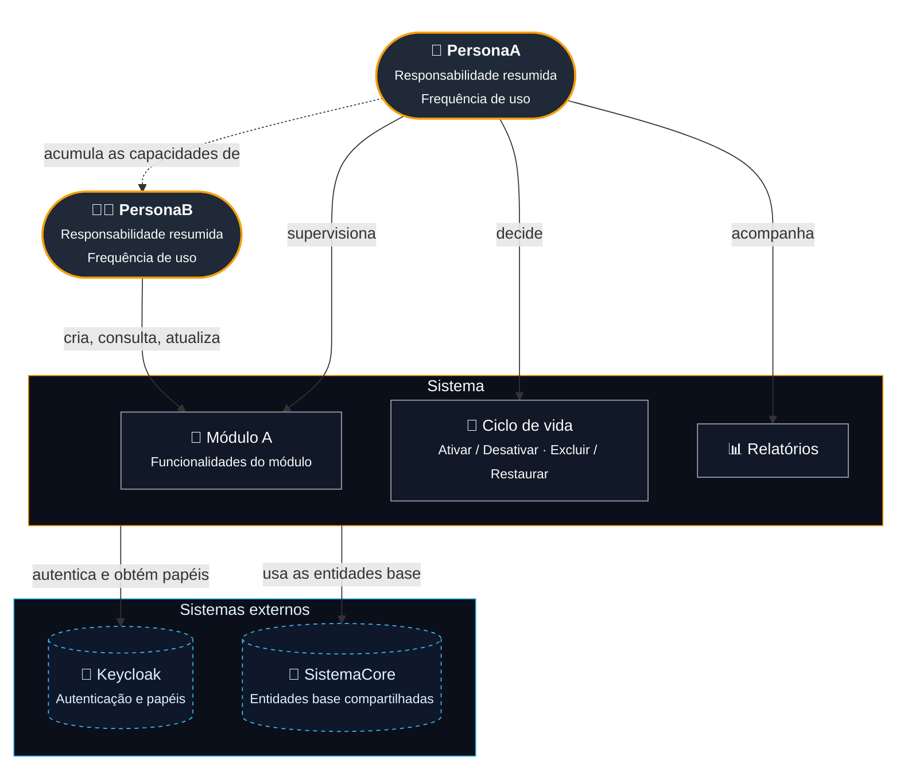
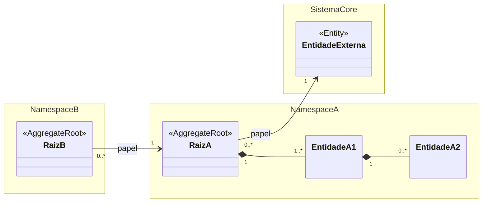
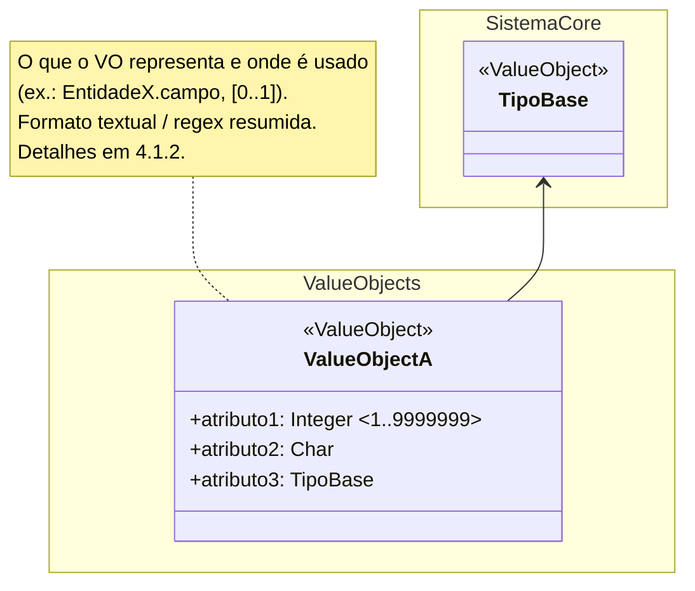
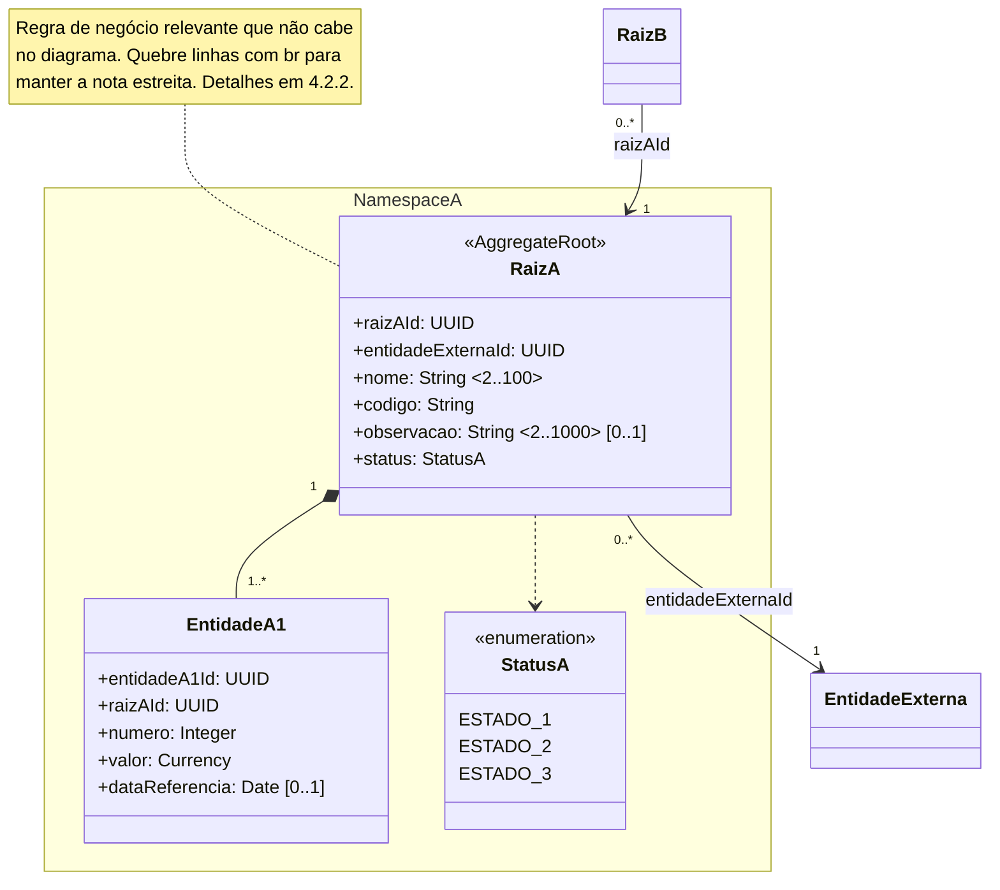
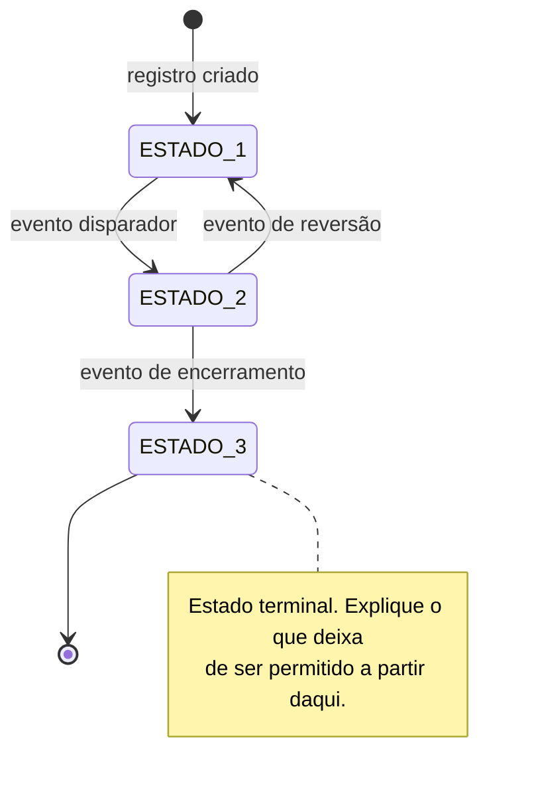

<!--
TEMPLATE — Modelo de domínio UML (DDD)

Como usar:
1. Copie este arquivo para `modelos/<sistema>-uml.md`.
2. Substitua os marcadores `{Sistema}`, `{sistemaCore}` etc. e os nomes de exemplo dos
   diagramas (`RaizA`, `EntidadeA1`, `StatusA` …) pelos nomes reais do domínio.
3. Substitua cada bloco `[...]` pelo conteúdo real e apague a orientação.
4. Seções marcadas como (opcional) podem ser removidas; se remover, renumere as
   seções seguintes e as referências cruzadas (ex.: "ver 4.9").
5. Antes de publicar, percorra o checklist no final deste arquivo e apague-o.

Convenções obrigatórias (valem para todo o documento):
- Idioma: português; nomes de classes e atributos em camelCase/PascalCase sem acento.
- Estereótipos: <<AggregateRoot>>, <<Entity>>, <<ValueObject>>, <<enumeration>>.
- Tipos primitivos: UUID, String, Integer, Decimal, Currency, Boolean, Date, DateTime, Char.
- Multiplicidade no diagrama: atributo sem anotação = 1 (obrigatório);
  opcional = sufixo `[0..1]`. Não usar `?`.
- Faixa no diagrama: `<min..max>` logo após o tipo (comprimento para String,
  valor para numéricos). Ex.: `+nome: String <2..100> [0..1]`.
- Chave compartilhada (papel Party/Role): `«PK,FK»` após o tipo.
- Associação interna ao agregado = composição (`*--`); associação entre
  agregados/namespaces = referência por ID (`-->`), rotulada com o atributo `*Id`.
- Namespaces no Mermaid não aceitam espaço nem barra: use `_` (ex.: `Venda_Contrato`)
  e acrescente `_` quando o namespace tiver o mesmo nome de uma classe (ex.: `Empreendimento_`).
- Referências cruzadas sempre por número de seção (ex.: "ver 4.9", "(7.1)").
-->

# Modelo UML — {Sistema} - {Descrição curta do sistema}

## 1. Objetivo

[Um parágrafo: o que o sistema controla, para quem, e a lista dos principais conceitos
cobertos pelo modelo (ex.: cadastro de X, vendas, recebíveis, eventos, documentos).]

A modelagem está organizada em **agregados de domínio**, com o objetivo de deixar claros:

- os limites transacionais;
- as raízes de agregado;
- as entidades pertencentes a cada agregado;
- as associações e cardinalidades;
- as principais regras de consistência.

[Use blocos de observação para as **decisões de modelagem** que o leitor precisa saber
antes de ler os diagramas: limites de agregado que podem mudar com escala, entidades
mantidas em outro sistema, atributos que foram deliberadamente achatados em vez de
virar entidade. Uma decisão por bloco.]

> Observação: os limites de agregado apresentados são uma proposta orientada à simplicidade. [Diga quais entidades poderiam ser promovidas a raízes independentes em cenário de alta concorrência ou volume.]

> Observação: [Entidade mantida em sistema externo, ex.: `Parceiro` e `Empresa` pertencem ao {sistemaCore}; o {Sistema} apenas os referencia por ID.]

> Observação: [Decisão de simplificação, ex.: vínculo 1..1 modelado como atributo direto em vez de entidade intermediária — e a condição em que essa decisão deve ser revista.]

<br>

## 1.1 Personas

O {Sistema} é operado por [perfil dos usuários, ex.: personas do backoffice web
(desktop-first)] autenticadas via [provedor, ex.: Keycloak]. [Como os usuários são
provisionados; se há autorregistro; como o papel (`role`) define as permissões.]

| Persona | Papel ({provedor de identidade}) | Contexto de uso | Responsabilidade no {Sistema} |
|---|---|---|---|
| <b>{PersonaA}</b> | `{papelA}` | [Dispositivo, frequência de uso] | [O que decide ou opera no sistema.] |
| <b>{PersonaB}</b> | `{papelB}` | [Dispositivo, frequência de uso] | [O que decide ou opera no sistema.] |

> Observação: [Hierarquia entre papéis, ex.: `{PersonaA}` acumula as capacidades de
> `{PersonaB}`. A separação exata de permissões por endpoint fica no provedor de
> identidade, não no modelo de domínio.]

[Diagrama de contexto: toda persona da tabela acima deve aparecer como nó, e todo
nó referenciado em uma seta deve estar declarado.]



<br><br>

---

# 2. Visão dos objetos de valor, das entidades e dos agregados

## 2.1 Value Objects e enumerações

[Uma linha por Value Object ou enumeração do modelo. Namespace = o da seção 4 em que
o tipo é definido.]

| Namespace | Classe | Tipo | Usada por |
|---|---|---|---|
| ValueObjects | `{ValueObjectA}` | Value Object | `{EntidadeQueUsa}` |
| {NamespaceA} | `{StatusA}` | Enumeração | `{RaizA}` |

## 2.2 Entidades

Entidades do domínio que **não são raízes de agregado**, agrupadas por namespace. As
entidades internas pertencem ao agregado indicado e só são acessadas por meio da sua
raiz. As raízes de agregado estão listadas na seção 2.3.

[Tipo: `Entidade interna`, `Entidade cadastral` ou `Papel de {Entidade}`.
Mantida em: `{Sistema}` ou o sistema externo que é dono do dado.]

| Namespace | Entidade | Tipo | Agregado | Mantida em | Responsabilidade |
|---|---|---|---|---|---|
| {NamespaceA} | `{EntidadeA1}` | Entidade interna | {AgregadoA} | {Sistema} | [Uma frase.] |
| {NamespaceExterno} | `{EntidadeExterna}` | Entidade cadastral | — | {sistemaCore} | [Uma frase.] |

## 2.3 Agregados

Raízes de agregado do {Sistema}, com o namespace em que cada uma está definida na
seção 4, as entidades internas que compõem o agregado e a responsabilidade da raiz.

| Namespace | Agregado | Raiz | Entidades internas | Responsabilidade |
|---|---|---|---|---|
| {NamespaceA} | {AgregadoA} | `{RaizA}` | `{EntidadeA1}`, `{EntidadeA2}` | [Uma frase.] |
| {NamespaceB} | {AgregadoB} | `{RaizB}` | — | [Uma frase.] |

[Se algum namespace da seção 4 **não** for agregado (ex.: papéis sobre uma entidade
externa), explique aqui por que ele não aparece na tabela.]

---

# 3. UML — visão dos agregados

As classes estão agrupadas nos mesmos **namespaces** utilizados nos modelos detalhados
da seção 4. [Diagrama apenas com nomes de classe e estereótipos; sem atributos.]



---

# 4. UML — modelos detalhados por namespace

O modelo detalhado foi separado em **um diagrama por namespace** (um por agregado ou
grupo de agregados). Em cada diagrama:

- as classes **pertencentes ao namespace** são detalhadas com todos os atributos;
- as classes **externas ao namespace** aparecem **apenas com o nome**, servindo como
  ponto de ancoragem da referência;
- são desenhadas somente as **associações externas de primeiro nível**, isto é, as
  associações que cruzam diretamente a fronteira do namespace;
- associações **internas** ao namespace são composições (entidades do agregado);
- associações **externas** são referências por ID.

### Notação de multiplicidade dos atributos

Vale o padrão UML: **atributo sem anotação tem multiplicidade `1`** — é obrigatório e
deve estar preenchido em todo registro persistido. Só a multiplicidade que difere de
`1` é anotada ao final da linha:

| Notação | Significado |
|---|---|
| *(sem anotação)* | obrigatório — exatamente um valor, nunca nulo |
| `[0..1]` | opcional — pode ser nulo |
| `[1..*]` / `[0..*]` | coleção obrigatória / opcional |
| `<min..max>` | faixa: comprimento para `String`, valor para tipos numéricos |

Regras adotadas:

- todo identificador (`*Id`) da própria entidade e todo `*Id` de vínculo com a raiz
  do agregado são obrigatórios;
- todo `*Id` de referência externa é obrigatório quando a associação é obrigatória e
  `[0..1]` quando é opcional — o que deve coincidir com a cardinalidade desenhada
  na associação correspondente;
- atributos de status e enumerações de ciclo de vida são obrigatórios;
- totalizadores calculados são obrigatórios, com valor `0` quando ainda não há
  movimento — nunca nulos;
- [outras regras gerais do domínio].

Alguns atributos são **condicionalmente obrigatórios**: são modelados como `[0..1]`
porque só se aplicam a parte dos registros, mas passam a ser exigidos quando a
condição é verdadeira. Todos estão consolidados na seção 4.{M+2}.

### Tabelas de atributos

Cada namespace traz, logo após o diagrama, uma tabela por classe. A coluna **Mult.**
segue a notação acima (`1` = obrigatório, `0..1` = opcional). A coluna **Range** traz
o intervalo anotado como `<min..max>` no diagrama; `—` indica ausência de limite. A
ordem das linhas é a mesma dos atributos no diagrama.

---

## 4.1 Namespace `ValueObjects` (opcional)

### 4.1.1 Modelo



### 4.1.2 Value Object `{ValueObjectA}`

[O que o conceito representa no mundo real, base legal ou normativa se houver, e por
que é obrigatório/opcional na entidade que o usa.]

Como Value Object, `{ValueObjectA}` é imutável e comparado por valor. Não possui
identificador próprio e é persistido embutido na linha da entidade que o usa. [Forma
textual de apresentação, ex.: `numero-categoria/uf`.]

| Atributo | Tipo | Mult. | Range | Descrição |
|---|---|---|---|---|
| `atributo1` | Integer | 1 | 1..9999999 | [Significado, formato, unicidade.] |
| `atributo2` | Char | 1 | — | [Valores possíveis e coerência com outros dados.] |
| `atributo3` | TipoBase | 1 | — | [Significado.] |

Invariantes:

- [um VO incompleto é inválido e não deve ser persistido];
- [valores permitidos por atributo];
- [expressão regular da forma textual, se houver].

---

## 4.2 Namespace `{NamespaceA}`

[Uma a três frases: o que o namespace agrupa e qual é a raiz do agregado.]

### 4.2.1 Modelo



### 4.2.2 Descrição dos atributos

#### `{RaizA}`

| Atributo | Tipo | Mult. | Range | Descrição |
|---|---|---|---|---|
| `raizAId` | UUID | 1 | — | Identificador da raiz do agregado. |
| `entidadeExternaId` | UUID | 1 | — | Referência a `{EntidadeExterna}` ({sistemaCore}). [Por que é obrigatória.] ([seção da invariante]) |
| `nome` | String | 1 | 2..100 | [Significado e onde é usado.] |
| `codigo` | String | 1 | — | [Formato; escopo de unicidade.] |
| `observacao` | String | 0..1 | 2..1000 | Texto livre para anotações internas. |
| `status` | StatusA | 1 | — | Situação do registro; ver a máquina de estados em 4.2.3. |

#### `{EntidadeA1}`

| Atributo | Tipo | Mult. | Range | Descrição |
|---|---|---|---|---|
| `entidadeA1Id` | UUID | 1 | — | Identificador da entidade. |
| `raizAId` | UUID | 1 | — | Vínculo com a raiz do agregado. |
| `numero` | Integer | 1 | — | [Significado; escopo de unicidade.] |
| `valor` | Currency | 1 | — | [Significado; se é copiado para outra entidade como snapshot.] |
| `dataReferencia` | Date | 0..1 | — | [Por que é opcional; se é condicionalmente obrigatório, citar 4.{M+2}.] |

### 4.2.3 Máquina de estados de `{StatusA}` (opcional)

[Obrigatória para toda enumeração de status com transições restritas. Diga o que
dispara as transições: eventos de outro agregado ou ações administrativas.]



| Estado | Significado | [Pergunta-chave, ex.: Vendável?] |
|---|---|---|
| `ESTADO_1` | [Significado. Estado inicial.] | [Sim/Não] |
| `ESTADO_2` | [Significado.] | [Sim/Não] |
| `ESTADO_3` | [Significado. Estado terminal.] | [Sim/Não] |

| Transição | Evento disparador | Regra / invariante relacionada |
|---|---|---|
| `ESTADO_1 → ESTADO_2` | [Evento] | [Regra, com referência de seção.] |
| `ESTADO_2 → ESTADO_1` | [Evento] | [Regra.] |
| `ESTADO_2 → ESTADO_3` | [Evento] | [Regra.] |

Transições não listadas são proibidas. [Cite as proibições que o leitor
provavelmente assumiria permitidas.]

---

## 4.{N} Namespace `{NamespaceB}`

[Repita a estrutura de 4.2 — 4.{N}.1 Modelo, 4.{N}.2 Descrição dos atributos,
4.{N}.3 Máquina de estados (opcional) — para cada namespace restante.]

---

## 4.{M+1} Mapa de associações entre namespaces

Resumo das associações que cruzam fronteiras de namespace, todas implementadas como
referência por ID:

| Origem (namespace) | Classe origem | Classe destino | Destino (namespace) | Atributo | Cardinalidade | Obrigatório |
|---|---|---|---|---|---|---|
| {NamespaceA} | `{RaizA}` | `{EntidadeExterna}` | {sistemaCore} | `entidadeExternaId` | `0..* → 1` | sim |
| {NamespaceB} | `{RaizB}` | `{RaizA}` | {NamespaceA} | `raizAId` | `0..* → 1` | sim |

A coluna **Obrigatório** reflete a multiplicidade do atributo na classe de origem:
`sim` corresponde ao atributo sem anotação no diagrama, `não` a `[0..1]` sem
condição, e `condicional` / `XOR` a `[0..1]` com regra de domínio adicional
(seção 4.{M+2}).

As composições internas de cada agregado seguem as cardinalidades já desenhadas nos
diagramas:

| Agregado | Composição | Cardinalidade |
|---|---|---|
| {AgregadoA} | `{RaizA}` → `{EntidadeA1}` | `1 → 1..*` |

---

## 4.{M+2} Atributos com obrigatoriedade condicional

Os atributos abaixo aparecem como `[0..1]` nos diagramas porque não se aplicam a
todos os registros, mas tornam-se obrigatórios quando a condição indicada é
verdadeira. São regras de domínio, e não restrições de coluna — em banco relacional
ficam como `NULL` permitido mais validação na aplicação ou `CHECK` condicional.

| Classe | Atributo | Obrigatório quando | Deve ser nulo quando |
|---|---|---|---|
| `{RaizA}` | `{atributo}` | [condição] | [condição ou —] |
| `{Classe}` | `{atributoX}` / `{atributoY}` | exatamente um dos dois (XOR) | o outro vínculo |

---

# 5. Associações e cardinalidades

[Uma subseção por agregado (ou grupo de papéis). Cada uma traz o bloco de
cardinalidades em texto e a explicação em prosa: o que cada lado significa, o que é
permitido historicamente e o que é proibido simultaneamente.]

## 5.1 {AgregadoA}

```text
{EntidadeExterna} 1 ---- 0..* {RaizA}

{RaizA}      1 ---- 1..* {EntidadeA1}
```

[Explicação das cardinalidades e das decisões de fronteira: o que pertence ao agregado
e o que foi deixado de fora, com remissão para onde está descrito.]

---

# 6. {Cadeia central do domínio} (opcional)

[Use quando o domínio tem uma cadeia de conceitos que costuma ser confundida (ex.:
venda → plano → conta a receber → parcela → cobrança → pagamento). Mostre a árvore,
defina cada conceito em uma frase e dê um cenário concreto que só o modelo separado
suporta.]

```text
{CONCEITO_1}
  |
  +--- {CONCEITO_2}
          |
          +--- {CONCEITO_3}
```

### {Conceito1}

Representa [uma frase].

### {Conceito2}

Representa [uma frase].

Isso permite o cenário:

```text
[exemplo concreto com identificadores e status]
```

---

# 7. Regras dos agregados

[Uma subseção por agregado da tabela 2.3, na mesma ordem. Mantenha o mesmo formato
em todas, inclusive nas raízes de eventos.]

## 7.1 {AgregadoA}

A raiz é:

```text
{RaizA}
```

Entidades internas:

```text
{RaizA}
 └── {EntidadeA1}
```

Principais invariantes:

- [invariante estrutural, ex.: `{EntidadeA1}` pertence a exatamente uma `{RaizA}`];
- [invariante de unicidade, com o escopo];
- [invariante de estado, ex.: só registros em `ESTADO_2` podem …];
- [invariante de totalizador, se houver].

[Se o agregado tiver evolução prevista para maior escala, descreva a divisão em
raízes independentes e a consequência sobre consistência (transacional → eventual).]

---

# 8. {Tópico específico do domínio} (opcional)

[Uma seção por tema que precisa de explicação além das invariantes: eventos
contratuais, histórico, integrações, alternativas de implementação relacional. Use
exemplos em blocos `text` e termine com a consequência prática da decisão.]

---

# {N-2}. Diagrama simplificado final

[Árvores em texto, em MAIÚSCULAS com `_`, uma por agregado ou grupo, mostrando apenas
a hierarquia e as referências por ID (`---->`).]

```text
{ENTIDADE_EXTERNA}
   |
   +---- {RAIZ_A}
             |
             +---- {ENTIDADE_A1}
```

---

# {N-1}. Raízes de agregado recomendadas

Na implementação inicial, as raízes de agregado são:

```text
{RaizA}
{RaizB}
```

As entidades:

```text
{EntidadeA1}
{EntidadeA2}
```

ficam subordinadas às respectivas raízes.

[Justifique as raízes não óbvias (ciclo de vida próprio) e as exclusões (entidades
mantidas em outro sistema). Diga qual seria o primeiro ponto a separar em um sistema
de maior escala e por quê.]

---

# {N}. Questões em aberto a validar com o cliente

[Premissas do modelo que ainda precisam de confirmação. Priorize as que mudam a
estrutura de tabelas: são baratas de resolver agora e caras depois.]

## {N}.1 {Pergunta em forma de pergunta?}

**Perguntar:** [a pergunta concreta, com exemplos de situações reais].

**Situação atual do modelo:** [suporta / não suporta, e por quê].

**Se a resposta for sim:** [mudança necessária, com a estrutura proposta]:

```text
{NovaEntidade}
  {raizId}
  {outroId}
  {atributo}   {valores possíveis}
```

[e as invariantes correspondentes.]

**Impacto adicional:** [outras áreas afetadas].

<!--
CHECKLIST DE REVISÃO (apague antes de publicar)

Consistência entre seções
- [ ] Toda classe dos diagramas da seção 4 aparece em 2.1, 2.2 ou 2.3.
- [ ] Toda raiz de 2.3 tem subseção em 7 e aparece em {N-1}.
- [ ] Toda persona da tabela 1.1 aparece no diagrama de contexto, e todo nó usado
      em uma seta está declarado.
- [ ] O diagrama da seção 3 tem as mesmas composições e cardinalidades dos diagramas
      da seção 4 e da tabela 4.{M+1}.
- [ ] Todo `*Id` de referência externa na seção 4 tem linha em 4.{M+1}, com a mesma
      cardinalidade e obrigatoriedade.
- [ ] Todo atributo condicional citado em notas ou tabelas está em 4.{M+2}.

Diagramas e tabelas
- [ ] Todos os namespaces da seção 4 têm tabela de atributos, na mesma ordem do diagrama.
- [ ] Multiplicidade opcional sempre como `[0..1]`, nunca `?`.
- [ ] Toda enumeração de status com transições restritas tem máquina de estados.
- [ ] Os diagramas Mermaid renderizam (preview do VS Code ou mermaid.live).

Texto
- [ ] Todas as referências "seção X" / "(X.Y)" apontam para a seção correta
      após renumeração.
- [ ] Nenhum resto de outro projeto (nomes de sistema, módulos, personas).
- [ ] Nenhum marcador `{...}` ou orientação `[...]` restante.
- [ ] Texto impessoal (sem "eu utilizaria").
-->
